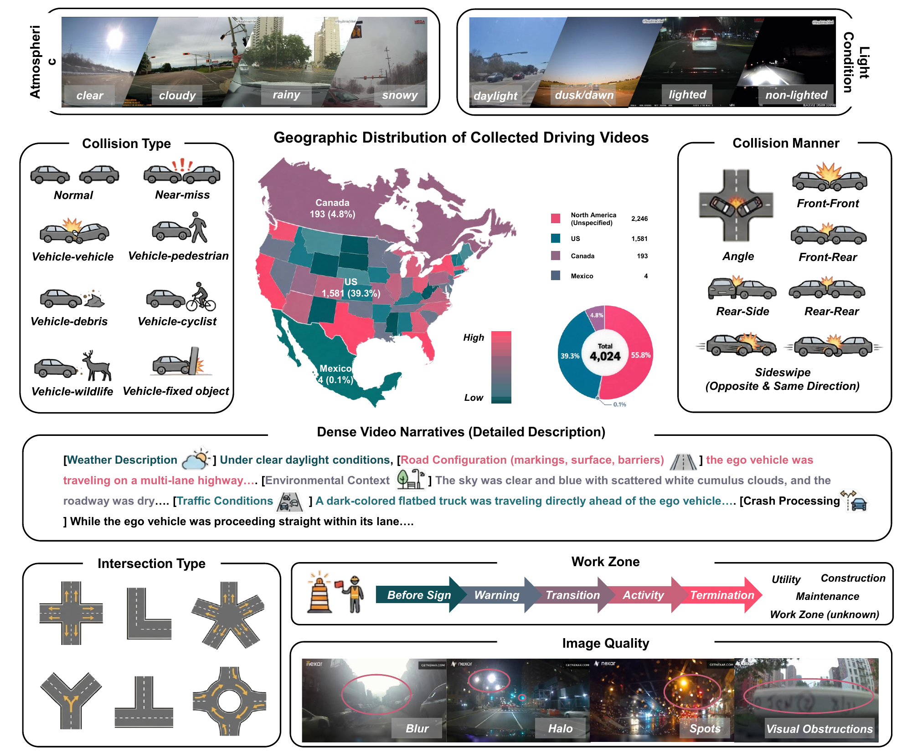
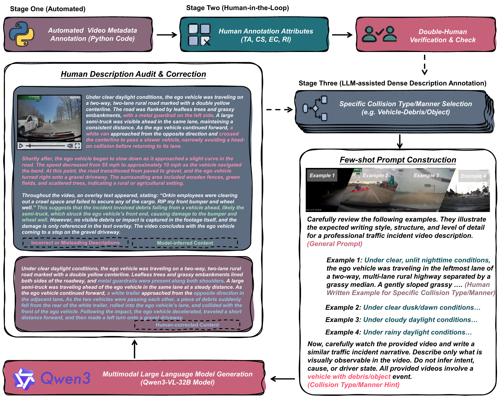
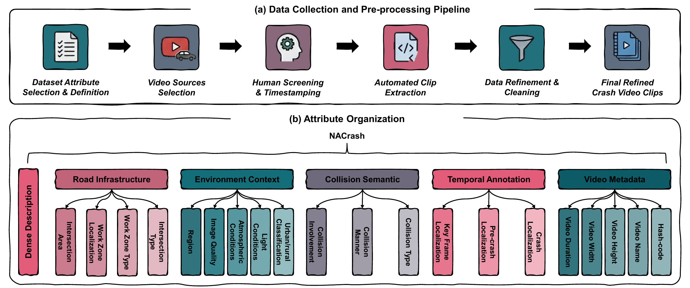
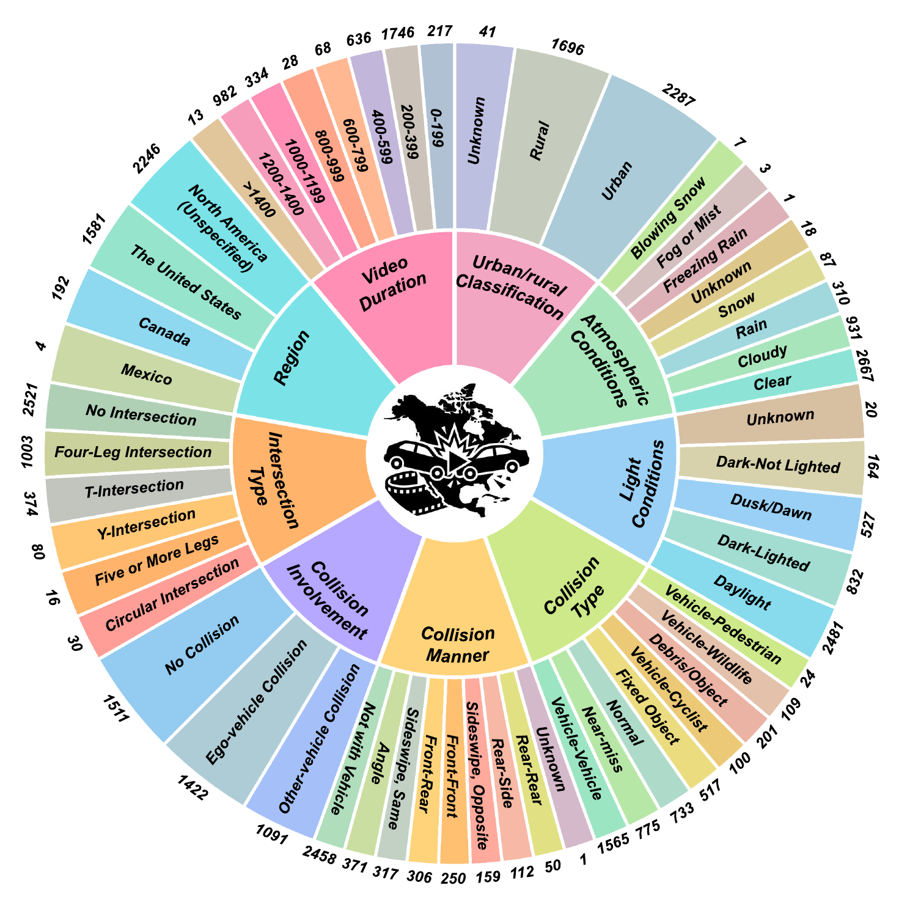
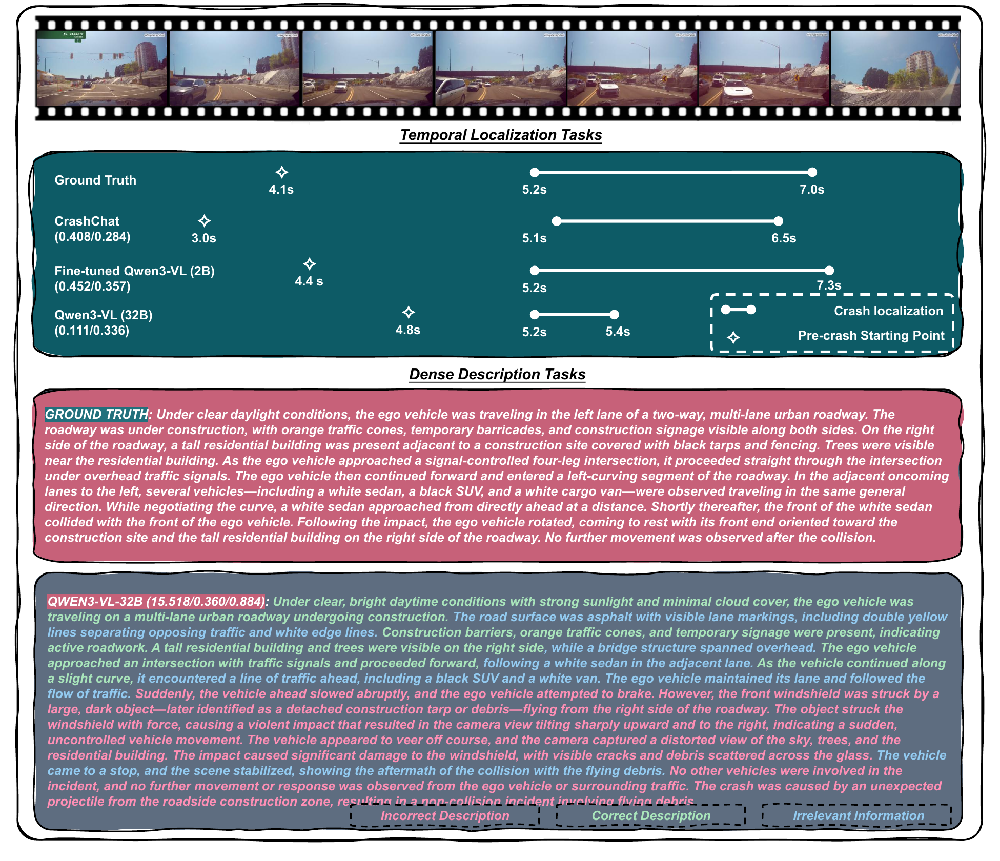

<h2 align="center"> <a href="">NACrash: A Densely Annotated North American Crash Video Dataset and Benchmark for Multimodal Large Language Models</a></h2>

<h4 align="center"> <a href="https://liangkd.github.io/">Kaidi Liang</a>, <a href="https://kelisbu.github.io/">Ke Li</a></h4>

<h5 align="center"> If our project helps you, please give us a star ⭐ on GitHub to support us. 🙏🙏 </h5>

<h5 align="center">

[](https://wacv.thecvf.com/)
[]()
[]()
[]()
</h5>

## 📰 News
- [26.10.16]  Our paper has been accepted by **WACV 2027 (Datasets Track)**. 🎉🎉🎉
- [26.10.16] Release the initial version of **NACrash**.
- [Coming soon] Release the **Datasets**, **NACrash-Bench**, and evaluation code.


## 🔗 Related Works from Our Group

- **[CrashChat](https://github.com/Liangkd/CrashChat)**: A Multimodal Large Language Model for Multitask Traffic Crash Video Analysis. [](https://github.com/Liangkd/CrashChat) [](https://arxiv.org/abs/2512.18878) [](https://github.com/Liangkd/CrashChat)
- **[CCFM](https://github.com/KELISBU/CCFM)**: Collision-Constrained Flow Matching for Safety-Critical Scenario Generation. [](https://github.com/KELISBU/CCFM) [](https://arxiv.org/abs/2607.04451) [](https://github.com/KELISBU/CCFM)


## 🌟 Introduction
- **NACrash** is a richly annotated dashcam crash video dataset collected from North American traffic environments. NACrash contains **4,024** video clips, comprising approximately **1.21 million frames** and **11.2 hours** of footage, with dense natural-language descriptions, multi-attribute annotations based on standards-aligned crash taxonomies, and **33,933** question-answering (QA) pairs. Our main contributions are:
  - (1) a vision-language dataset for understanding safety-critical video events, which provides standardized crash attributes following the Model Minimum Uniform Crash Criteria (MMUCC) guideline, dense natural-language descriptions, and 33,933 QA pairs;
  - (2) a semi-automatic, multi-dimensional annotation pipeline based on standardized crash terminology and taxonomies, enabling scalable dense annotations;
  - (3) **NACrash-Bench**, a balanced benchmark containing **1,000 videos** and **8,700 QA pairs** with strict balancing over collision types and collision manners;
  - (4) a comprehensive evaluation of 13 general-purpose and 2 crash-specific MLLM configurations across nine crash video understanding tasks, with an in-depth analysis of the capabilities and limitations of existing models.
- Evaluation shows that general-purpose MLLMs perform well in recognizing general scene attributes and describing overall driving contexts, but struggle with crash-specific tasks that require domain knowledge and fine-grained temporal reasoning. Fine-tuning MLLMs on NACrash substantially improves crash-specific reasoning.

<p align="center" width="100%">
<a target="_blank"></a>
</p>


## 📊 NACrash Dataset

#### Data Sources
NACrash focuses on North American traffic crash videos curated from two sources: the [Nexar dataset](https://huggingface.co/datasets/nexar-ai/nexar_collision_prediction) and YouTube crash videos. Low-quality Nexar samples are filtered out, and YouTube videos featuring North American driving scenarios are manually identified, trimmed, and cleaned.

| Source | # Videos |
|--------|---------:|
| Nexar | 1,458 |
| YouTube | 2,566 |
| **Total** | **4,024** |

#### Annotation
We define **21 key attributes** organized into six categories: Video Metadata (VM), Temporal Annotation (TA), Collision Semantics (CS), Environmental Context (EC), Road Infrastructure (RI), and Dense Description (DD). Annotation follows a semi-automated three-stage framework:
- **Stage 1 (Automated):** video metadata is extracted with Python scripts.
- **Stage 2 (Human-in-the-loop):** structured crash attributes (TA, CS, EC, RI) are manually annotated and verified through a double-review procedure.
- **Stage 3 (MLLM-assisted):** dense descriptions are generated by Qwen3-VL-32B with collision-type/manner-specific few-shot prompts, then manually audited to remove hallucinated, misleading, or visually unverifiable statements.

<p align="center" width="100%">
<a target="_blank"></a>
</p>

<details>
  <summary>💡Click here to show the attribute organization and data collection pipeline</summary>
  
</details>

<details>
  <summary>💡Click here to show the multi-dimensional attribute distributions of NACrash</summary>
  
</details>

#### Tasks
Based on these annotations, we formulate nine crash video understanding tasks spanning three perspectives:

| Category | Task | Description |
|----------|------|-------------|
| Video Classification | Urban/Rural Classification (URC) | Identify the surrounding road environment |
| Video Classification | Atmospheric Recognition (AR) | Recognize weather conditions |
| Video Classification | Lighting Condition Recognition (LR) | Determine illumination conditions |
| Video Classification | Collision-Type Classification (CTC) | Classify the high-level crash type |
| Video Classification | Collision-Manner Classification (CMC) | Identify the manner of collision |
| Video Classification | Collision-Involvement Classification (CIC) | Recognize the involved road users or objects |
| Temporal Localization | Pre-crash Localization | Identify the earliest timestamp when crash risk becomes perceptible |
| Temporal Localization | Crash Localization | Identify the temporal boundaries of the crash event |
| Dense Description | Crash Description | Describe scene context, temporal evolution, and participant interactions |

#### Splits

| Split | # Videos | # QA pairs | Usage |
|-------|---------:|-----------:|-------|
| NACrash (all) | 4,024 | 33,933 | Full dataset |
| NACrash-Bench | 1,000 | 8,700 | Balanced benchmark for evaluation |
| NACrash (non-benchmark) | 3,024 | 25,233 | Training / fine-tuning |


## 🤗 Example Outputs
- **Qualitative comparison of dense description and temporal localization tasks**

<p align="center" width="100%">
<a target="_blank"></a>
</p>


<details>
  <summary>💡Click here to show zero-shot performance of MLLMs on NACrash-Bench</summary>

| Model | Size | URC | AR | LR | CTC | CMC | CIC | Crash mIoU | Crash Hit30 | Crash Hit50 | Crash Hit70 | Pre-crash mIoU | Pre-crash Hit30 | Pre-crash Hit50 | Pre-crash Hit70 | BLEU | ROUGE | BERT |
|---|---|---|---|---|---|---|---|---|---|---|---|---|---|---|---|---|---|---|
| ***General MLLM*** | | | | | | | | | | | | | | | | | | |
| InternVL3.5 | 1B | 0.769 | 0.603 | 0.562 | 0.320 | 0.022 | 0.264 | 0.052 | 0.066 | 0.018 | 0.005 | 0.055 | 0.066 | 0.056 | 0.043 | 3.764 | 0.217 | 0.856 |
| Qwen3-VL | 2B | 0.760 | 0.672 | 0.672 | 0.452 | 0.011 | 0.434 | 0.213 | 0.293 | 0.155 | 0.066 | 0.126 | 0.158 | 0.133 | 0.096 | 8.889 | 0.265 | 0.861 |
| InternVL3.5 | 2B | 0.780 | 0.622 | 0.614 | 0.345 | 0.096 | 0.398 | 0.019 | 0.015 | 0.005 | 0.001 | 0.087 | 0.101 | 0.093 | 0.078 | 10.370 | 0.300 | 0.875 |
| Qwen3-VL | 4B | 0.808 | 0.795 | 0.697 | 0.492 | 0.353 | 0.451 | 0.227 | 0.304 | 0.170 | 0.083 | 0.305 | 0.395 | 0.313 | 0.223 | 12.950 | 0.328 | 0.878 |
| InternVL3.5 | 4B | 0.751 | 0.706 | 0.685 | 0.492 | 0.402 | 0.345 | 0.040 | 0.041 | 0.013 | 0.005 | 0.023 | 0.034 | 0.021 | 0.011 | 8.649 | 0.283 | 0.872 |
| LLaVA-OneVision-1.5 | 4B | 0.775 | 0.753 | 0.639 | 0.295 | 0.387 | 0.118 | 0.005 | 0.008 | 0.003 | 0.000 | 0.024 | 0.033 | 0.021 | 0.015 | 13.091 | 0.312 | 0.876 |
| VideoLLaMA3 | 7B | 0.744 | 0.730 | 0.688 | 0.334 | 0.024 | 0.378 | 0.207 | 0.284 | 0.114 | 0.035 | 0.197 | 0.235 | 0.206 | 0.153 | 10.467 | 0.288 | 0.870 |
| Qwen3-VL | 8B | 0.790 | 0.804 | 0.686 | **0.548** | 0.424 | 0.392 | 0.214 | 0.299 | 0.156 | 0.061 | 0.276 | 0.368 | 0.281 | 0.199 | 14.117 | 0.345 | 0.881 |
| InternVL3.5 | 8B | 0.778 | 0.812 | 0.699 | 0.464 | 0.343 | 0.277 | 0.043 | 0.058 | 0.029 | 0.010 | 0.019 | 0.024 | 0.019 | 0.013 | 6.498 | 0.261 | 0.869 |
| LLaVA-OneVision-1.5 | 8B | 0.800 | 0.724 | 0.643 | 0.248 | 0.456 | 0.137 | 0.003 | 0.003 | 0.003 | 0.000 | 0.005 | 0.008 | 0.005 | 0.004 | 9.366 | 0.271 | 0.870 |
| InternVL3.5 | 14B | **0.838** | 0.808 | 0.713 | 0.524 | **0.463** | 0.362 | 0.033 | 0.046 | 0.020 | 0.006 | 0.050 | 0.061 | 0.048 | 0.038 | 14.205 | 0.342 | 0.883 |
| Qwen3-VL | 32B | 0.774 | 0.761 | 0.684 | 0.536 | 0.457 | **0.537** | 0.111 | 0.130 | 0.059 | 0.014 | **0.336** | **0.443** | **0.353** | **0.240** | **15.518** | **0.360** | **0.884** |
| InternVL3.5 | 38B | 0.797 | **0.821** | **0.714** | 0.454 | 0.277 | 0.362 | 0.029 | 0.044 | 0.015 | 0.004 | 0.112 | 0.134 | 0.114 | 0.095 | 13.861 | 0.341 | **0.884** |
| ***Crash-specific MLLM*** | | | | | | | | | | | | | | | | | | |
| CrashChat | 7B | 0.695 | 0.755 | 0.684 | 0.376 | 0.040 | 0.457 | **0.408** | **0.606** | **0.396** | **0.201** | 0.284 | 0.295 | 0.258 | 0.211 | 9.377 | 0.294 | 0.871 |
| EchoTraffic | 7B | 0.442 | 0.282 | 0.432 | 0.274 | 0.013 | 0.230 | 0.082 | 0.111 | 0.048 | 0.011 | 0.000 | 0.000 | 0.000 | 0.000 | 0.768 | 0.157 | 0.851 |

**Bold** indicates the best performance in each column.
</details>


## 📦 Data Release

The dataset, NACrash-Bench, and evaluation code will be released soon. Stay tuned!

- **Nexar subset:** video clips and annotations will be distributed strictly in accordance with the redistribution permissions and licensing terms of the original Nexar dataset.
- **YouTube subset:** we release only source URLs and annotations, without redistributing the original videos.
- **License:** NACrash-created artifacts (annotations, QA pairs, and benchmark metadata) will be released under the [CC BY-NC 4.0](https://creativecommons.org/licenses/by-nc/4.0/) license. Copyright and ownership of all original videos remain with their respective content owners or data providers.


## 🛠️ Requirements and Installation

Coming soon.


## ✅ Evaluation

Coming soon.


## 📑 Citation

If you find NACrash useful for your research and applications, please cite using this BibTeX:

```bibtex
@inproceedings{liang2027nacrash,
  title     = {NACrash: A Densely Annotated North American Crash Video Dataset and Benchmark for Multimodal Large Language Models},
  author    = {Liang, Kaidi and Li, Ke},
  booktitle = {Proceedings of the IEEE/CVF Winter Conference on Applications of Computer Vision (WACV)},
  year      = {2027}
}
```

## 👍 Acknowledgement

We gratefully acknowledge the open-source projects and datasets that inspired and supported this work, including Nexar, MMUCC, MM-AU, Qwen3-VL, InternVL3.5, LLaVA-OneVision-1.5, VideoLLaMA3, EchoTraffic, and [CrashChat](https://github.com/Liangkd/CrashChat). Their contributions to vision-language modeling and real-world traffic understanding have been invaluable.


## :earth_americas: Contact

If you have any question, please feel free to email me (kaidi.liang@stonybrook.edu) or leave a comment under the 'Issues' module. Thank you!

